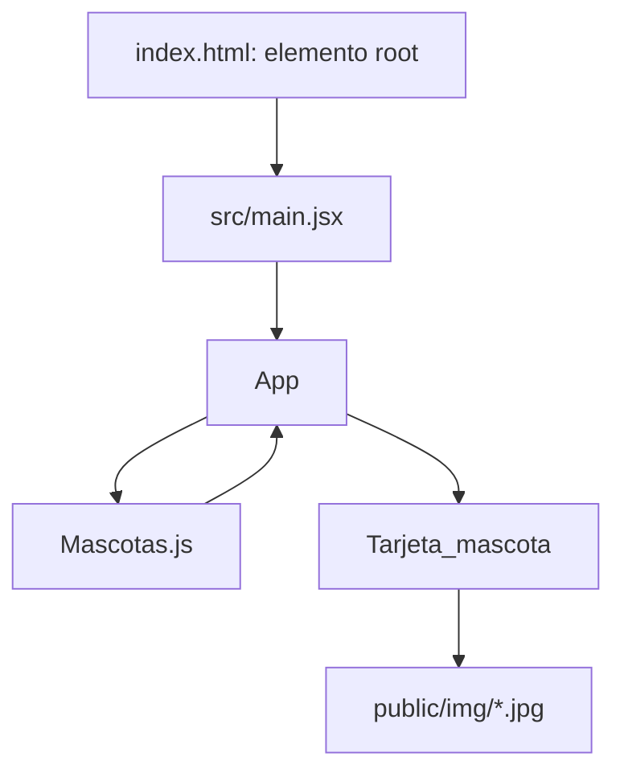
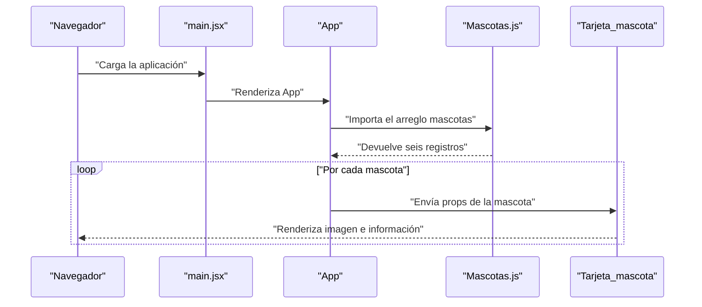

# Tarjeta Mascotas

[](https://react.dev/)
[](https://vite.dev/)
[](https://eslint.org/)
[](https://github.com/Campriet03/Tarjeta-Mascotas)
[](#licencia)

Aplicación web académica desarrollada con React que presenta tarjetas con información de mascotas disponibles para adopción. Permite consultar la especie, raza, edad, peso y estado de vacunación de cada mascota desde un catálogo local.

El proyecto forma parte de la formación académica en Tecnología en Desarrollo de Software de Uniagustiniana, Bogotá, Colombia.

## Tabla de contenidos

- [Características principales](#características-principales)
- [Capturas de pantalla](#capturas-de-pantalla)
- [Arquitectura](#arquitectura)
- [Modelo de datos](#modelo-de-datos)
- [Sistema de diseño](#sistema-de-diseño)
- [Stack tecnológico](#stack-tecnológico)
- [Estructura del proyecto](#estructura-del-proyecto)
- [Requisitos previos](#requisitos-previos)
- [Instalación y ejecución](#instalación-y-ejecución)
- [Uso](#uso)
- [Configuración](#configuración)
- [Pruebas y despliegue](#pruebas-y-despliegue)
- [Limitaciones conocidas](#limitaciones-conocidas)
- [Roadmap](#roadmap)
- [Guía de contribución](#guía-de-contribución)
- [Créditos y licencia](#créditos-y-licencia)
- [Autor](#autor)

## Características principales

- Catálogo de seis mascotas definido en [src/Data/Mascotas.js](src/Data/Mascotas.js).
- Renderizado de una tarjeta por mascota mediante `Mascotas.map()`.
- Información de nombre, especie, raza, edad, peso y estado de vacunación.
- Visualización de una imagen local para cada registro.
- Diseño adaptable mediante contenedores flexibles.
- Estados visuales de interacción para tarjetas y botones mediante CSS.

## Capturas de pantalla

| Vista | Ruta de referencia | Estado |
|---|---|---|
| Página principal | `docs/img/tarjeta-mascotas.png` | `<!-- TODO: agregar captura -->` |
| Vista móvil | `docs/img/tarjeta-mascotas-mobile.png` | `<!-- TODO: agregar captura -->` |

## Arquitectura

### Visión general

La aplicación usa una arquitectura sencilla basada en componentes React. Los datos se importan desde un módulo JavaScript local; `App` transforma el arreglo en componentes tarjeta y `main.jsx` monta React en el elemento `root` de `index.html`.

Principios observables:

- Flujo de datos descendente mediante props de `App` hacia `Tarjeta_mascota`.
- Datos centralizados en un único módulo.
- Separación básica entre montaje, composición visual, presentación y catálogo.
- Renderizado sin estado global, hooks ni persistencia.

### Diagrama de componentes



### Diagrama de secuencia del flujo principal



### Módulos y responsabilidades

| Capa o módulo | Responsabilidad |
|---|---|
| `index.html` | Contiene el elemento `root` y carga `src/main.jsx`. |
| `src/main.jsx` | Inicializa React DOM y monta `App` dentro de `StrictMode`. |
| `src/App.jsx` | Importa el catálogo, construye el título y crea una tarjeta por registro. |
| `src/Components/Tarjeta_mascota.jsx` | Presenta los datos recibidos como props y el botón visual. |
| `src/Data/Mascotas.js` | Contiene el catálogo estático de mascotas. |
| `src/App.css` | Define la composición, tarjetas, imágenes, botones y estados hover. |
| `src/index.css` | Define estilos globales base importados por `main.jsx`. |

### Decisiones técnicas clave

| Decisión | Contexto y justificación observable |
|---|---|
| Catálogo JavaScript local | Permite reutilizar los datos sin configurar una API o base de datos. |
| React sin estado global | La funcionalidad actual solo lee y representa datos. |
| Vite | El proyecto usa los scripts definidos en `package.json`. |
| CSS dividido en dos archivos | `index.css` contiene estilos globales y `App.css` estilos específicos. |

### Consideraciones técnicas

- **Seguridad:** el catálogo es público y de solo lectura; no procesa credenciales ni datos de usuario.
- **Escalabilidad:** el arreglo puede crecer, pero no tiene paginación ni búsqueda.
- **Rendimiento:** el catálogo contiene seis elementos. No se implementa carga diferida ni optimización de imágenes.

## Modelo de datos

El catálogo se almacena únicamente en memoria. No existe base de datos ni persistencia.

| Entidad | Campo | Tipo observado | Ejemplo |
|---|---|---|---|
| Mascota | `id` | Número | `1` |
| Mascota | `nombre` | Texto | `Max` |
| Mascota | `especie` | Texto | `Perro` |
| Mascota | `raza` | Texto | `Labrador` |
| Mascota | `edad` | Número | `5` |
| Mascota | `peso` | Número | `50` |
| Mascota | `vacunado` | Booleano | `true` |
| Mascota | `imagen` | Ruta pública | `/img/labrador.jpg` |

## Reglas de negocio

No existe lógica de adopción ni persistencia de solicitudes. Las reglas visibles son de presentación:

- Cada elemento se identifica mediante `id` y la tarjeta usa ese valor como `key`.
- `vacunado` determina el texto mostrado: `Sí` cuando es verdadero y `No` en caso contrario.
- Edad y peso se presentan con las unidades `años` y `kg`.

## Sistema de diseño

La interfaz utiliza una paleta púrpura definida parcialmente en CSS.

| Elemento | Valor |
|---|---|
| Fondo principal | Gradiente de `#caa8ff` a `#a87fd9` |
| Fondo de tarjeta | `#f3f3f3` |
| Texto de tarjeta | `#333` |
| Fondo del botón | `#4b2ea7` |
| Fondo hover del botón | `#3a1d7c` |
| Radio de tarjeta | `15px` |
| Radio de imagen | `10px` |
| Fuente del cuerpo en `App.css` | `Arial, sans-serif` |
| Fuente base en `index.css` | `system-ui`, `Avenir`, `Helvetica`, `Arial`, `sans-serif` |

## Stack tecnológico

| Tecnología | Versión declarada | Rol |
|---|---|---|
| React | `^19.2.0` | Construcción de componentes de interfaz. |
| React DOM | `^19.2.0` | Montaje de React en el DOM. |
| React Router DOM | `^7.13.2` | Dependencia instalada; el código actual no define rutas. |
| Vite | `^8.0.0-beta.13` | Servidor de desarrollo y compilación. |
| ESLint | `^9.39.1` | Análisis estático del código JavaScript. |
| CSS | Nativo | Estilos de la aplicación. |

## Estructura del proyecto

```text
tarjeta_mascotas/
├── index.html                 # Documento HTML y punto de entrada
├── package.json               # Dependencias y scripts npm
├── vite.config.js             # Configuración de React en Vite
├── eslint.config.js           # Reglas de ESLint
├── public/
│   ├── vite.svg               # Recurso del template de Vite
│   └── img/                   # Imágenes de las mascotas
└── src/
    ├── main.jsx               # Montaje de React
    ├── App.jsx                # Composición de tarjetas
    ├── App.css                # Estilos de la interfaz principal
    ├── index.css              # Estilos globales
    ├── Components/
    │   └── Tarjeta_mascota.jsx
    └── Data/
        └── Mascotas.js        # Catálogo local de mascotas
```

## Requisitos previos

- Node.js: `<!-- TODO: no se fijó una versión mínima -->`.
- npm: incluido normalmente con Node.js; versión no especificada.
- Navegador web compatible con aplicaciones React modernas.
- Git, opcional para clonar el repositorio.

## Instalación y ejecución

```bash
git clone https://github.com/Campriet03/Tarjeta-Mascotas.git
cd Tarjeta-Mascotas
npm install
npm run dev
```

Abra la dirección local mostrada por Vite en la terminal.

### Construcción de producción

```bash
npm run build
```

El resultado se genera en el directorio `dist`.

### Vista previa de la construcción

```bash
npm run preview
```

### Análisis estático

```bash
npm run lint
```

## Uso

Al abrir la aplicación se muestra el encabezado `Adopta una mascota` y una cuadrícula flexible con tarjetas.

Cada tarjeta muestra:

1. Imagen de la mascota.
2. Nombre.
3. Especie.
4. Raza.
5. Edad en años.
6. Peso en kilogramos.
7. Estado de vacunación.

Ejemplo de registro:

```text
Nombre: Max
Especie: Perro
Raza: Labrador
Edad: 5 años
Peso: 50 kg
Vacunado: Sí
```

El botón `Ver detalles` aparece visualmente, pero no tiene manejador de eventos ni navegación asociada.

## Configuración

Para agregar o modificar mascotas, edite el arreglo exportado por [src/Data/Mascotas.js](src/Data/Mascotas.js).

Cada mascota debe conservar estos campos:

```js
{
  id: 1,
  nombre: "Max",
  especie: "Perro",
  raza: "Labrador",
  edad: 5,
  peso: 50,
  vacunado: true,
  imagen: "/img/labrador.jpg"
}
```

Las imágenes referenciadas desde `/img/...` deben colocarse en `public/img/`.

## Pruebas y despliegue

El proyecto incluye linting, pero no contiene pruebas automatizadas ni configuración de despliegue en el repositorio.

No se encontraron variables de entorno ni archivos `.env`.

## Limitaciones conocidas

### Funcionales

- El botón `Ver detalles`, declarado en `Tarjeta_mascota.jsx`, no ejecuta ninguna acción ni navegación.
- El catálogo es estático y no permite crear, editar, eliminar ni marcar mascotas como adoptadas.
- React Router está instalado en `package.json`, pero no hay rutas configuradas.

### Validaciones y datos

- `Mascotas.js` no valida campos obligatorios ni tipos antes de renderizarlos.
- Los registros de peso y edad no tienen validaciones de rango.

### Accesibilidad

- Los elementos de imagen usan `alt={nombre}`; no se encontró una etiqueta textual específica para el botón.
- El botón visual carece de funcionalidad asociada.

### Compatibilidad y presentación

- `src/index.css` establece `min-width: 320px`, por lo que el comportamiento exacto por debajo de ese ancho no está definido.
- Los estilos globales de `index.css` y `App.css` se aplican simultáneamente y pueden solaparse.

### Mantenibilidad

- No existen pruebas automatizadas.
- No hay separación entre servicios de datos y componentes más allá del arreglo local.

## Roadmap

- [ ] <!-- TODO: confirmar prioridad --> Implementar la acción del botón `Ver detalles`.
- [ ] <!-- TODO: confirmar prioridad --> Agregar búsqueda y filtros por especie, raza o estado de vacunación.
- [ ] <!-- TODO: confirmar prioridad --> Incorporar pruebas unitarias y de componentes.
- [ ] <!-- TODO: confirmar prioridad --> Validar los registros del catálogo.
- [ ] <!-- TODO: confirmar prioridad --> Resolver la cascada entre los estilos de `index.css` y `App.css`.
- [ ] <!-- TODO: confirmar prioridad --> Definir una licencia.

## Guía de contribución

1. Cree una rama descriptiva desde `main`, por ejemplo `feature/filtros-mascotas`.
2. Realice cambios pequeños asociados a una sola funcionalidad o corrección.
3. Ejecute antes de entregar:

```bash
npm run lint
npm run build
```

4. Use el formato Conventional Commits:

```text
feat: agrega filtro por especie
fix: corrige ruta de imagen de mascota
docs: actualiza instrucciones de instalación
```

5. Abra una solicitud de cambios hacia `main`, describiendo el problema, los cambios y las verificaciones realizadas.

## Créditos y licencia

Las imágenes utilizadas por la aplicación se encuentran en `public/img`. Sus fuentes y condiciones de uso deben ser verificadas por el autor.

### Licencia

`<!-- TODO: seleccionar y agregar una licencia -->`

Hasta que se publique una licencia, todos los derechos deben asumirse reservados por defecto.

## Autor

**Camilo Alejandro Prieto Villarreal**

- GitHub: [https://github.com/Campriet03](https://github.com/Campriet03)
- Repositorio: [https://github.com/Campriet03/Tarjeta-Mascotas](https://github.com/Campriet03/Tarjeta-Mascotas)
- Formación académica: Tecnología en Desarrollo de Software, Uniagustiniana (Bogotá, Colombia).

<!--
INFORMACIÓN PENDIENTE
- Versión mínima de Node.js.
- URL pública de despliegue, si existe.
- Capturas de pantalla en docs/img/.
- Licencia y condiciones de uso de las imágenes.
- Fuentes de las fotografías almacenadas en public/img/.
- Variables de entorno: no se encontraron actualmente.
- Prueba automatizada o suite de testing: no existe actualmente.
- Configuración de despliegue: no existe actualmente.
-->
